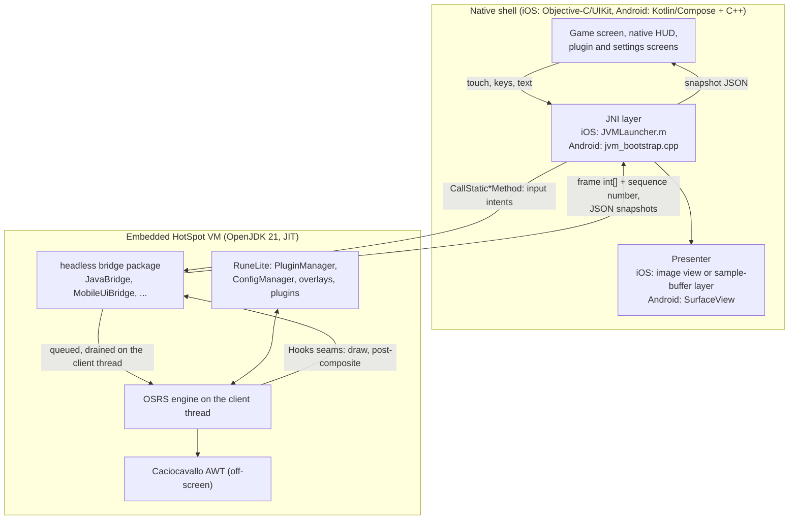

# Architecture

This page explains how RuneMobile is put together: the three layers, how each port boots to the login screen,
how a frame reaches the screen, how a touch reaches the game, which thread may touch what, and why the
design looks the way it does. Read it before your first change to the bridge or to either shell; most of
the traps elsewhere in this guide come from one of the rules described here.

RuneMobile is a personal, technical project. A self-built client is not on Jagex's approved-client list, so
playing live OSRS with it carries a ban risk: use a throwaway Jagex account, never a main. See the
[README](../../README.md) for the full risk statement.

## The short version

RuneMobile does not reimplement RuneLite. Each app embeds a real OpenJDK 21 HotSpot VM, with its JIT, inside
the app process and runs the unmodified RuneLite client and game engine on it. AWT runs off-screen on
Caciocavallo, so the engine draws into an ordinary `int[]` frame buffer. A small Java package,
`net.runelite.client.headless`, is the only seam between the engine and the native app: the native shell
calls its public static methods through JNI to send input and to read frames and JSON snapshots.



The GPU and 117HD renderers add a second path: the engine's GL calls go through a per-port GL facade
straight to the platform's OpenGL ES. [renderers.md](renderers.md) covers that path.

## The three layers

The code is split into three layers, which older commits and comments call W1, W2 and W3.

### W1: the platform (an embedded OpenJDK 21 with a JIT)

Each app process already has a runtime of its own (the Objective-C runtime on iOS, ART on Android). The
shell starts a **second, in-process HotSpot VM** through the JNI Invocation API: it `dlopen`s the bundled
`libjvm`, looks up `JNI_CreateJavaVM` with `dlsym`, and creates the VM on a dedicated native thread.

- **iOS** creates the VM on an `NSThread` named `jvm-main` with a 16 MB stack
  (`startVmThreadWithLauncher:` in `ios/app/RuneMobile/ViewController.m`, `runProbesWithLog:` in
  `ios/app/RuneMobile/JVMLauncher.m`). It calls `JNI_CreateJavaVM` directly rather than going through the JDK
  launcher (`JLI_Launch`), because the launcher's first-thread handling re-enters `main` and UIKit refuses a
  second `UIApplication`.
- **Android** creates the VM on a detached pthread (`jvmThreadMain` in
  `android/app/src/main/cpp/jvm_bootstrap.cpp`). The Kotlin side calls it through `JvmLauncher.startJvm`,
  which blocks until the VM exists or reports an error code that the boot screen shows.

**The JIT.** HotSpot's JIT needs memory that is writable and then executable. Android grants that to any app,
so the Android port needs no workarounds. iOS does not: the bundled `libjvm` is patched to map its code cache
through a debugger (a `brk #0x69` trap that StikDebug answers), and the launcher adds the matching VM options
(`-XX:+MirrorMappedCodeCache` and friends, in `runProbesWithLog:`). That is why iOS needs a StikDebug attach
on every launch and why the app waits on its play screen until it sees one. The iOS Simulator build answers
the same trap in-process, so it needs no attach. The patched `libjvm` cannot run with the JIT turned off.
[ios.md](ios.md) covers the attach in detail.

**The VM is never torn down in-app.** `DeviceHeadlessBoot.main` returns after a fixed window
(`-Dheadless.runSeconds`, set by each launcher), but the engine's own non-daemon threads keep the session
running. The native thread that created the VM then parks for the life of the process (`for (;;) sleep` on
iOS, `while (true) pause()` on Android). Nothing clears the VM handle and nothing calls `DestroyJavaVM`:

- An earlier iOS build cleared its VM handle when `main` returned. Every later input call then thought the
  bridge was gone, so taps stopped working a few minutes into each session while the game kept rendering.
- `DestroyJavaVM` would be worse: it waits for the engine's threads to exit and then unloads the VM while the
  UI thread may still be calling into it.

A future "quit session" button must stop every JNI caller first, then clear the VM handle, then call
`DestroyJavaVM`, in that order. The comment above the park loop in `JVMLauncher.m` records this.

**AWT without a window system.** The engine is an AWT `Applet` that draws to a `Canvas`, and RuneLite's side
panels are Swing. Neither iOS nor Android has a desktop AWT backend, so RuneMobile runs AWT on
[Caciocavallo](https://github.com/CaciocavalloSilano/caciocavallo)'s CTC toolkit, which renders components
into an off-screen virtual display. On JDK 21 the usual `-Dawt.toolkit` property is ignored and the standard
way of swapping the graphics environment needs the instrumentation API, which the device JREs cannot use.
`UnsafePokeActivation` (in `ios/dev-tools/awtsmoke/`) installs the CTC toolkit and graphics environment by
writing the JDK's static fields directly, in an order that matters. It is the first Java step of every boot.
[`ios/dev-tools/awtsmoke/README.md`](../../ios/dev-tools/awtsmoke/README.md) records how that recipe was found.

The device JREs are built xawt-style, so `java.awt.Toolkit`'s static initialiser loads `libawt_xawt`, which
neither JRE ships. Each port builds a small fake `libawt_xawt` that exposes the real `libawt_headless` natives
plus no-op stubs for the desktop component `initIDs` functions (safe, because CTC's peers are pure Java and
never use them). There are two builds on purpose, because the link rules differ:

| Port | Library | How it reaches `libawt_headless` | Build script |
|---|---|---|---|
| iOS | `libawt_xawt.dylib` (Mach-O) | re-exports it | [`ios/dev-tools/fake-xawt/build-libawt_xawt.sh`](../../ios/dev-tools/fake-xawt/build-libawt_xawt.sh) |
| Android | `libawt_xawt.so` (bionic ELF) | `DT_NEEDED libawt_headless.so` | [`android/dev-tools/fake-xawt/build-libawt_xawt.sh`](../../android/dev-tools/fake-xawt/build-libawt_xawt.sh) |

> **Trap (Android boot order):** `UnsafePokeActivation.activate()` must run before the native side resolves
> `JavaBridge`. `JavaBridge`'s static initialiser creates a `java.awt.Color`, which initialises
> `java.awt.Toolkit`; if CTC is not installed yet, the bionic JRE tries to load the stock xawt backend and
> the boot dies. Android therefore calls `activate()` from native code right after `JNI_CreateJavaVM`, before
> `publishBridge`. iOS resolves the bridge lazily from the main thread, after `DeviceHeadlessBoot.main` has
> already activated CTC, so it never hits this.

### W2: the headless core

W2 is plain Java inside the RuneLite tree, shared by both ports.

- **Entry point.** Both ports call `DeviceHeadlessBoot.main`
  ([`ios/dev-tools/awtsmoke/DeviceHeadlessBoot.java`](../../ios/dev-tools/awtsmoke/DeviceHeadlessBoot.java),
  built into `probes.jar`). It activates CTC and calls `RuneLiteHeadless.main` with `--disable-telemetry`
  (plus `--safe-mode` unless a launcher flag turns safe mode off).
- **`RuneLiteHeadless`** points RuneLite's session ping at an unreachable local address (see
  [PRIVACY.md](../../PRIVACY.md)), installs `HeadlessModule` as RuneLite's override module, and calls the
  stock `RuneLite.main`. RuneLite then boots exactly as on desktop: Guice injector, `ConfigManager`,
  `PluginManager`, plugin hub, gamepack.
- **`HeadlessModule`** binds `ClientUI` to
  [`HeadlessClientUI`](../../runelite-client/src/main/java/net/runelite/client/ui/HeadlessClientUI.java), a
  window-less subclass. It keeps the Swing look-and-feel (plugin side panels are real Swing components,
  rendered off-screen), hosts the gamepack in a minimal AWT `Frame` so its `Canvas` gets a CTC peer, seeds two
  privacy defaults (Loot Tracker and Chat Commands off unless the user has set them), and wires the bridges
  that need injected services (`MobileUiBridge.init`, `ConfigProfileBridge.init`, the HUD pre-render listener,
  `JavaBridge.setClientThread`). Navigation buttons that desktop would put in the sidebar are forwarded to
  `MobileUiBridge`, which lists them for the native panel screen.
- **Seams in upstream code.**
  [`Hooks.java`](../../runelite-client/src/main/java/net/runelite/client/callback/Hooks.java) gains three
  one-line calls into `HeadlessSeams`: `draw` (at the top of every `Hooks.draw`, once per engine frame),
  `postComposite` (after the last overlays are painted, where the frame is copied out) and `drawScene` (each
  3D scene draw).
  `HeadlessSeams` dispatches to the bridges and wraps each call in a guard that logs the throwable through
  `BridgeFaults` instead of letting one failing bridge kill the engine's frame. The HUD's pre-render work runs
  from a last-priority `BeforeRender` event subscriber, so it needs no extra edit to `Hooks`.
- **The bridge package**, `runelite-client/src/main/java/net/runelite/client/headless/`, is the whole API the
  shells see. [bridge-api.md](bridge-api.md) tours it class by class.

Upstream edits are kept small so upstream merges stay clean. To list every upstream file the fork touches:

```sh
git diff --name-status upstream/master...HEAD -- runelite-client
```

### W3: the native shells

Each port has its own native app. They share no code; they share the Java runtime and the bridge contract.

| | iOS | Android |
|---|---|---|
| Language and UI | Objective-C, UIKit (no Swift) | Kotlin, Jetpack Compose, plus C++ |
| Project definition | `ios/app/project.yml` (XcodeGen) | `android/app/build.gradle.kts` |
| JVM bootstrap and JNI | `ios/app/RuneMobile/JVMLauncher.m` | `android/app/src/main/cpp/jvm_bootstrap.cpp`, `JvmLauncher.kt` |
| Game screen, gestures, HUD | `ios/app/RuneMobile/ViewController.m` | `MainActivity.kt` and the Compose screens beside it |
| GL bridge (GPU, 117HD) | `ios/dev-tools/gpu-routec/`, `ios/dev-tools/gpu-zone/` | `android/app/src/main/cpp/librlawt.cpp` |

[ios.md](ios.md) and [android.md](android.md) walk through each shell's files.

## Boot sequence

Both ports end up running the same Java boot. They differ in what happens before the VM exists.

### iOS

1. **Wait for the JIT.** The play screen polls for the debugger attach (`CS_DEBUGGED`) every 0.2 s and enables
   Play once it sees one. In the Simulator there is nothing to wait for.
2. **Log in if needed.** With no `tokens.json`, the app shows the Jagex login. That screen uses WebKit, and
   once WebKit has run in a process it takes over the exception port the JIT trap needs. The app therefore
   asks for a one-tap restart after a fresh login, so the VM starts in a clean process.
3. **Pick a renderer.** On first run `GLRecon` probes the GPU and recommends a default (`117hd`, `gpu` or
   `cpu`). A crash cookie written before a GPU boot falls the next launch back to CPU if the GPU renderer never
   presents a frame.
4. **Start the VM thread** (`jvm-main`, 16 MB stack) and run `runProbesWithLog:`, which:
   - chooses the RuneLite home (`user.home`), Documents in a Debug build and Application Support in a Release
     build;
   - pins the game's saved display mode to resizable before the engine reads it;
   - exports the Jagex session from `tokens.json` as `JX_*` environment variables (they must be set before
     `JNI_CreateJavaVM`, because HotSpot snapshots the environment at startup);
   - builds the VM options (JIT options, Caciocavallo `--add-opens`/`--add-exports`, heap cap `kMaxHeapMb`,
     `-XX:+ExitOnOutOfMemoryError`, the bridge `-D` flags) and the class path from the bundled jars;
   - calls `JNI_CreateJavaVM`, registers the GL facade natives (`RegisterNatives`), and calls
     `DeviceHeadlessBoot.main`.
5. **Resolve the bridge.** The main thread's display tick calls `ensureBridge()` until the VM and `JavaBridge`
   are ready, then starts pulling frames.

### Android

1. **Unpack the runtime.** `AssetInstaller.ensureInstalled` copies the JRE and jars from the APK's assets
   into the app's files directory when the bundled `runtime.tag` differs from the installed one, so an
   update re-extracts and a normal launch does not.
2. **Log in if needed.** With no usable `tokens.json`, the app shows the Jagex login first.
3. **Pick a renderer.** The persisted choice wins. On first run `probeGpuCaps()` stands up a throwaway GLES
   context and picks a default; an `auto-gpu-armed` marker plays the same crash-cookie role as on iOS.
4. **Build the options** in `bootJvm` (`MainActivity.kt`): heap cap `MAX_HEAP_MB`, Caciocavallo flags,
   `java.io.tmpdir` inside the files directory (Android has no `/tmp`, and `Font.createFont` needs one), the
   bridge `-D` flags, the renderer flags, and the `JX_*` environment from `JagexTokens`. It pins the display
   mode the same way iOS does.
5. **Create the VM** (`jvmThreadMain` in `jvm_bootstrap.cpp`): `dlopen` `libjvm.so`, `JNI_CreateJavaVM`,
   `UnsafePokeActivation.activate()`, then `publishBridge` (the boot fails if `JavaBridge`'s essential
   methods do not resolve). In GPU or 117HD mode it then `dlopen`s `librlawt.so` and registers the GL facade
   natives. It starts the native render thread and calls `DeviceHeadlessBoot.main`.

### The shared Java boot

From `DeviceHeadlessBoot.main` on, both ports run the same code:

1. CTC activation, then `RuneLiteHeadless.main`, then the stock `RuneLite.main`.
2. RuneLite loads its config profile, core plugins and installed hub plugins, then the gamepack. The gamepack
   cache lives under `user.home/.runelite/jagexcache/oldschool/LIVE`.
3. The engine starts drawing. Each `Hooks.draw` runs the bridge ticks; each post-composite copies the frame
   out, and the shell's next tick picks it up.
4. With the `JX_*` session present, the gamepack authenticates but stops on the "Play Now" welcome screen.
   `HeadlessLogin` (armed by `-Drunelite.headless.autologin`) clicks it, and on a fresh install clicks the
   EULA's Accept first. After login it also dismisses the game's "Click here to play" screen, and the HUD
   bridges take over.
5. Once in the world, `RouteCGpuStarter` or `RLHDStarter` starts the chosen GPU renderer, and
   `RendererPanelStarter` loads the other renderer plugins without starting them so they appear in the
   plugin list.

## The frame path

The engine draws on its client thread into `MainBufferProvider`, an AWT-backed `int[]` buffer. At the
post-composite seam, `JavaBridge.snapshot` copies that buffer into one of two private buffers, publishes it
through a `volatile` field and increments the frame sequence number last. The native side reads the
sequence number, skips the frame if it has not changed, and otherwise copies the pixels out
(`getFrameWidth`, `getFrameHeight`, `getFramePixels`).

```
client thread                         native side
-------------                         -----------
engine draws -> MainBufferProvider
Hooks post-composite
  JavaBridge.snapshot:
    copy into bufA or bufB
    publish frame (volatile)
    frameSeq++              --------> getFrameSeq() changed?
                                        getFramePixels() -> copy -> present
```

**iOS.** A `CADisplayLink` on the main thread calls `onDisplayTick`, which asks `+[JVMLauncher latestFrame]`
for a `CGImage` (copied from the Java array into a small ring of native buffers) and shows it in a
`UIImageView`. On devices that support Picture in Picture, an `AVSampleBufferDisplayLayer` is the visible
presenter instead; a separate JVM-attached feed thread copies each new frame into IOSurface-backed pixel
buffers, holding the `GetPrimitiveArrayCritical` window only for the copy. The image view then stays as a
slow fallback.

**Android.** The native render thread (`renderLoop` in `jvm_bootstrap.cpp`) is paced to vsync. Each pass it
blits the latest frame to the `SurfaceView`'s `ANativeWindow`, drains the input queue into the bridge,
polls the small read-only values the UI needs (text input open, tap kind) and re-copies any JSON snapshot
whose publish sequence moved. When the app is in the background it only drains input, a few times a second.

**GPU renderers.** On iOS the base GPU renderer reads its finished frame back into the same `int[]` path
(`gpuFrameBackBuffer`, then `gpuPublish`, which holds frames back until the scene has warmed up), while 117HD
presents straight to a native GL-backed layer. On Android both GPU renderers present straight to the
`SurfaceView` through EGL, and the render thread skips its blit. See [renderers.md](renderers.md).

## The input path

Input never touches the engine from a native thread. The shell turns gestures into calls on `JavaBridge`
(`onClick`, `onClickPrecise`, `onTouch`, `onMove`, `onWheel`, `onCameraDrag`, `onText`, `onKeyStroke` and
others), and each call enqueues an intent that the client thread drains in `JavaBridge.tapTick`.

- **iOS.** UIKit gesture recognizers run on the main thread and call `+[JVMLauncher post...]` class methods,
  which call the bridge directly through JNI (the main thread is attached to the VM).
- **Android.** Compose and `View` touch handlers run on the ART UI thread, which is never attached to HotSpot.
  They call `JvmLauncher.nativeClick` and friends, which push an event onto a native queue; the render
  thread drains it (`drainInput`) and makes the bridge calls.

On the client thread a tap is resolved the way a desktop click is: the engine builds its menu for that
point and the top entry runs. The bridge then publishes what the tap did (`getLastTapKind`, with
`getTapKindSeq` advancing once per resolved tap) so the shell can draw the yellow or red click marker.
Camera drags accumulate in atomic counters and are applied once per tick. Synthetic key presses are spaced
out by a pacing executor so they do not arrive faster than a person could type.

Two kinds of input need care:

- **The chatbox** does not respond reliably to synthetic clicks. Its buttons are driven by invoking the
  engine's own menu actions instead. [gotchas.md](gotchas.md) has the details.
- **Native views drawn over the game** take touches before the game screen sees them. A native control that
  covers part of the game (a chat pill, a HUD button) has to pass touches through where the game should get
  them. A bridge fix that works on one port can still be blocked by such a view on the other.

## Threading model

The rules are written down in
[`runelite-client/src/main/java/net/runelite/client/headless/package-info.java:32-66`](../../runelite-client/src/main/java/net/runelite/client/headless/package-info.java).
Read that block before you "fix" anything that looks under-synchronized. In short:

1. **Each native thread attaches itself, as a daemon, and keeps its own `JNIEnv`.** A thread that calls into
   HotSpot attaches with `AttachCurrentThreadAsDaemon` the first time and is never detached. A `JNIEnv` is
   valid only on the thread that got it; never hand one to another thread. Only global `jclass` references
   and `jmethodID`s are cached, once. The helpers are `bridgeEnvAttach()` on Android and `ensureBridge()` on
   iOS. (iOS keeps the main thread's env in `gMainEnv` and uses it only from the main thread.)
2. **All engine state changes happen on the single client thread.** Input arrives as queued intents.
   Snapshots the shells read are built on the client thread and published as an immutable `volatile`
   reference that readers load without a lock: one writer, one publish, many readers.
3. **Values cross the boundary as copies.** Strings and arrays are copied out of the Java heap before the
   native side uses them. Keep the `GetPrimitiveArrayCritical` window around the frame copy tight, with no JNI
   calls inside it.

The threads involved:

| Thread | Port | Attached to HotSpot | Role |
|---|---|---|---|
| Client thread | both | Java thread | Runs the engine and plugins' client-thread work; drains input; builds snapshots. |
| AWT event dispatch thread | both | Java thread | Swing panels; plugin start and stop (`PluginManager` asserts it). |
| `jvm-main` | both | created the VM | Runs `DeviceHeadlessBoot.main`, then parks forever. |
| Main (UI) thread | iOS | yes (daemon) | Gestures, display tick, frame and snapshot reads, bridge calls that enqueue. |
| Frame feed thread | iOS | yes (daemon) | Copies frames into the Picture in Picture layer. |
| UI thread | Android | **never** | Pushes input onto the native queue; reads native copies of snapshots. Attaching it risks an ANR. |
| Render thread | Android | yes (daemon) | Vsync blit, input drain, snapshot republish. |
| `rl-bridge` executor | Android | yes (daemon) | Plugin list, config, panel and data-screen calls (`JvmLauncher.onBridge`). |

`MobileUiBridge` has two lanes for this reason: plugin start and stop go to the event dispatch thread,
config writes and game reads go to the client thread. A shell calls the bridge method from its own thread
and the bridge hops to the right lane.

> Which threads attach differs by port. On iOS the UI thread attaches and calls the bridge directly. On
> Android the UI thread is never attached; the render thread and the `rl-bridge` executor make every call.

## The shared runtime

The Java source is the same on both ports. The jars are not.

| | iOS | Android |
|---|---|---|
| Jars | `client-shaded.jar`, `probes.jar`, `client-rlhd.jar`, `routec-l1.jar` | `client-<version>-gpu.jar`, `client-<version>-rlhd.jar`, `probes.jar` |
| File names | version-agnostic | carry the RuneLite version, plus a `runtime.tag` |
| Where they live | the app bundle (`ios/app/jvm-resources/` when staged) | APK assets, unpacked to the app's files directory |
| Class path | `client-shaded : probes : client-rlhd` | `gpu : rlhd : probes` (every mode boots the GPU jar) |

Each port rebuilds the shaded client jar for its own GL stack: LWJGL's GL classes are replaced by a facade
whose natives the shell registers, and each port lays its own Java and shader overrides over the pinned 117HD
source. Only `probes.jar` comes out byte-identical, so jar SHAs never match across ports.
[PORTS.md](../../PORTS.md) has the full table and the staging scripts.

There is no `shared/` Gradle module and no umbrella build. A shared module would pull Android Gradle Plugin
assumptions into normal RuneLite work and make upstream merges harder, for little gain. The shared edge is held
by convention and by checks instead: the contract scan, the bridge censuses and the port-drift report, all
described in [bridge-api.md](bridge-api.md).

The RuneLite version is not written down anywhere in this guide on purpose. Read it from
`gradle.properties` (`project.build.version`).

> **Trap (iOS staging):** stage the iOS jars with the iOS stagers under `ios/dev-tools/gpu-routec/` and
> `ios/dev-tools/gpu-zone/`. `tools/stage-mobile-runtime.sh` run without `--android-only` copies the
> pristine jar over `client-shaded.jar` and drops the GL facade; `ios/app/scripts/check-staged-jar.sh` then
> fails the Xcode build. [setup.md](setup.md) has the full staging order for both ports.

## Plugins and configuration

`PluginManager` is RuneLite's own, unmodified. Core plugins load from the client jar; hub plugins download
and load as on desktop. The plugin hub is pinned to a released RuneLite version
(`runelite.pluginhub.version` in
[`runelite.properties`](../../runelite-client/src/main/resources/net/runelite/client/runelite.properties),
which iOS also passes on its command line), because the hub serves manifests for releases only.
`tools/shared-contract/check-hub-pin.sh` stops a release once the RuneLite version moves past the last
reviewed pin.

The native screens reach plugins through bridges, never through direct calls on the UI thread:

- **Plugin list, config, hub, hotkeys, notifications, notes, game settings**: `MobileUiBridge`. Reads return
  JSON; writes are fire-and-forget with a write id the shell can poll (`getProcessedWriteId`).
- **Side panels**: a plugin's Swing panel is rendered off-screen and shown as an image, with taps, text,
  keys and scrolls forwarded back (`MobileUiBridge.openPanel`, `getPanelPixels`, `panelClick`, ...).
- **Native data screens**: XP Tracker, Loot Tracker, Grand Exchange, Time Tracking, Quest Helper and World
  Switcher have dedicated bridges that read the plugin's state on the client thread and publish JSON, so the
  shells draw real native controls instead of a picture of the Swing panel.
- **Config profiles**: `ConfigProfileBridge`.

`ConfigManager` saves to disk on its own schedule. Both shells ask for a flush (`flushConfig` or
`flushConfigQueued`) when a settings screen closes or the app goes to the background, so a kill does not
lose recent changes.

## Login, auth and reconnect

**Jagex login.** The native login screen (`ios/app/RuneMobile/JagexLoginViewController.m`,
`android/app/src/main/java/dev/audaro/runemobile/JagexLogin.kt`) runs Jagex's OAuth flow and writes the
resulting session to `tokens.json` before the VM starts. The launcher turns it into the `JX_*` environment
variables the gamepack reads when it is started by the official launcher. There is no shared Java code for
this step, so [`tools/shared-contract/auth-contract.json`](../../tools/shared-contract/auth-contract.json)
pins the wire constants (endpoints, client ids, scopes, response keys) across the iOS, Android and desktop
script implementations, and `check-auth-contract.sh` fails when they drift. A RuneLite (runelite.net) account
is a separate, optional login handled by `RuneLiteAccountBridge`.

**Play Now.** The `JX_*` session authenticates the account but does not enter the game; the gamepack waits on
the welcome screen. `HeadlessLogin` clicks "Play Now" for the user (and the EULA's Accept on a fresh install),
retrying a bounded number of times.

**Reconnect.** When the connection drops, the engine goes from `LOGGED_IN` through `CONNECTION_LOST` to the
login screen. `HeadlessLogin` notices the drop and logs in again: it clicks "Try again" on the failure dialog
and then "Play Now", with a bounded number of cycles and a backoff between attempts. While that runs,
`MobileChromeBridge`'s snapshot reports it and the shell shows a "Reconnecting" overlay. If every attempt
fails, the snapshot reports an expired session and the shell asks the user to sign in again. This is a fresh
login, not a resumed session: the game sees a new login, as it would after a desktop client reconnects.

Use a throwaway Jagex account for all of this, including development.

## Where things are stored

| What | iOS | Android |
|---|---|---|
| RuneLite home (`user.home`): `.runelite/` with settings, profiles, hub plugins, `client.log` and the game cache | Debug: Documents. Release: Application Support (not visible in Files). | the app's files directory |
| Jagex session (`tokens.json`) | Application Support (`+[JVMLauncher tokensPath]`) | the app's files directory; Debug builds also read the app's external files directory |
| Native shell settings | `NSUserDefaults` (`RMGameSettings`) | `SharedPreferences` file `game_settings` (`GameSettings.kt`) |
| JRE and jars | read-only in the app bundle | unpacked from APK assets into the files directory |

Logging out deletes `tokens.json`. Logs and how to pull them are covered in [debugging.md](debugging.md).

## Renderers

RuneMobile ships three renderers, all of them RuneLite's own: the engine's CPU rasteriser, the GPU plugin, and
117HD (the RLHD hub plugin, pinned to a reviewed revision and staged into its own jar). GPU and 117HD are
offered as defaults only after a live capability probe on the device, and a crash cookie falls back to CPU if a
GPU boot never presents a frame. Each port supplies its own GL bridge under the unmodified plugin code.
[renderers.md](renderers.md) covers the facades, the shader overrides and the probes.

## Design decisions

**A real JVM, not a reimplementation.** The goal is RuneLite's plugin ecosystem unmodified, and plugins
assume a full JVM: they are loaded from the hub at run time, use reflection, Guice and Swing, and are
updated independently of this repo. That rules out ahead-of-time approaches (GraalVM native image, Java
translated to C or Objective-C) because they need the whole program at build time. An interpreter-only JVM was
tried first and measured 45 to 184 times slower than HotSpot with its JIT, too slow for the engine. So both
ports run HotSpot with its JIT, and iOS pays for that with the per-launch StikDebug attach.

**Keep the renderers upstream's.** The GPU and 117HD plugins run as published. Rather than rewriting them for
Metal or Vulkan, each port provides a GL facade underneath them and a small set of shader and Java overrides,
so a 117HD update is a re-pin and a re-check rather than a port.

**R8 and minification are off.** The shells find Java classes and methods by name through JNI, RuneLite and
its plugins lean on reflection, and the APK's size is dominated by the JRE and jars, which R8 cannot shrink.
The Android release build type says so in `android/app/build.gradle.kts`.

**Reconnect is a re-login.** Resuming a dropped game session would mean reaching into the engine's network
state. Re-running the same login the user already did is simpler and behaves like the desktop client.

**Jagex's client rules shape the HUD.** RuneMobile follows the published rules for third-party clients. In
practice: never resize, move or rearrange the click zones inside the inventory, worn equipment, spellbook,
combat options or prayer panels, and never resize those panels. Scaling the whole client uniformly is fine.
Moving a whole panel while keeping it at its normal size is accepted; upstream RuneLite already lets desktop
users drag the side panel container around. When a HUD change would touch one of those panels, move the whole
panel or leave it alone.

**No backend, no telemetry.** The app talks to Jagex (login and game), to RuneLite's own services as stock
RuneLite does (hub, world list, prices), and to nothing run by this project. Telemetry is off and the session
ping goes nowhere. [PRIVACY.md](../../PRIVACY.md) is the authoritative list.

**Nothing proprietary in the repo.** No Jagex art is committed: interface sprites the native HUD shows are read
from the player's own game cache at run time, as the desktop client does. The JREs and the staged jars are not
committed either; they are fetched or built locally, as [setup.md](setup.md) describes.

## See also

- [bridge-api.md](bridge-api.md): the bridge package, the contract, and how to change it safely.
- [bridge-api-reference.md](bridge-api-reference.md): every bridge method, JSON key and `-D` flag.
- [renderers.md](renderers.md): CPU, GPU and 117HD, the GL facades and the capability probe.
- [ios.md](ios.md) and [android.md](android.md): each shell's files and build.
- [gotchas.md](gotchas.md): the traps that have cost the most time.
- [PORTS.md](../../PORTS.md): what each port bundles and how the shared edge is held.
